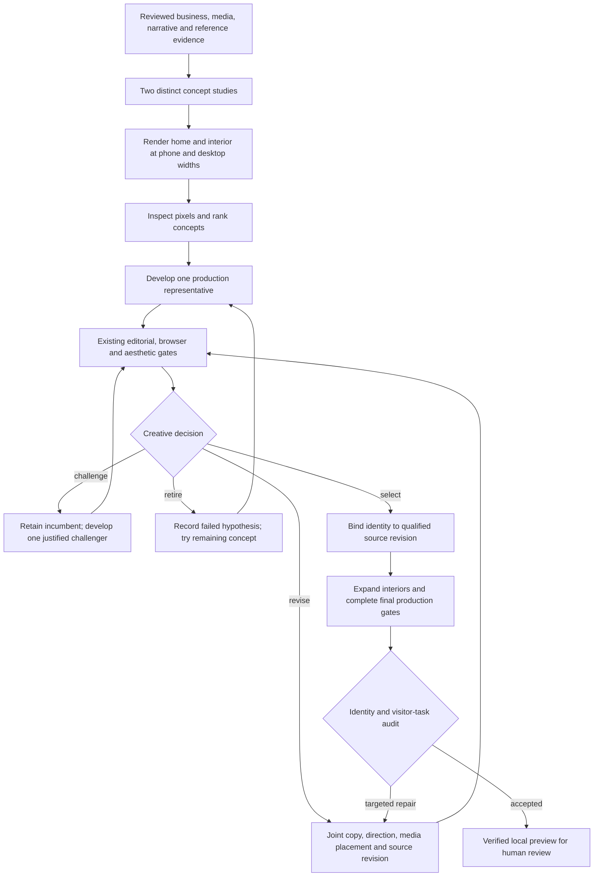

# Creative orchestrator implementation

The opt-in creative profile now creates `orchestratorVersion: 2` runs. It operates inside the current active-agent session. The engine prepares an objective, yields through `agent/CURRENT.md`, validates the returned artifacts, and chooses the next objective. Browser and compiler tools execute normally; creative authoring and criticism remain in the active session. `activeAgentOnly` prevents an installed quality-reviewer adapter from launching another model worker inside this profile.

The product objective is a distinctive, coherent website that helps visitors accomplish the business's actual goals. More alternatives, more graph nodes, and more agent activity are not success criteria. Human review occurs on the finished site. The engine does not introduce a concept-selection approval gate.

For the next supervised customer build, start the opt-in [creative context preset](CREATIVE-EFFICIENCY.md) with the short [customer kickoff](CUSTOMER-KICKOFF.md). It retains one active-agent session, starts with two inexpensive rendered concepts, develops the stronger one, and ends at a verified local preview. A third concept or challenger needs a material unresolved design question. The isolated [readiness smoke run](../artifacts/creative-readiness-20260928/readiness.md) exercises this path; it does not establish human preference or conversion lift.

## Architecture and ownership

| Module | Responsibility |
| --- | --- |
| `src/agent/creative-profile.ts` | Durable phase machine, isolated candidates, automatic decisions, shared budget, final audit and preview handoff |
| `src/agent/creative-objective.ts` | Temporary objective preparation, lifecycle completion receipts, safe retry and stale-result rejection |
| `src/agent/creative-revision.ts` | Joint creative authoring scope, contract validation, source adoption and fresh review invalidation |
| `src/agent/creative-prompts.ts` | Business-specific concept invention and sequential visitor/art-director/skeptic/editor reasoning |
| `src/agent/creative-contract.ts` | Versioned briefs, candidates, located findings, decisions, revision plans and final audits |
| `src/agent/creative-skills.ts` | Prerequisite graph, advisory links and effective managed instruction expansion |
| `src/agent/creative-evidence.ts` | Site-local evidence graph, provenance, bounded traversal and objective retrieval |
| `src/agent/creative-evaluation.ts` | Prospective matched evaluation protocol and immutable input identities |

The creative coordinator owns selection and experiment records. Candidate sites own production source. Existing content, browser and visual gates retain their acceptance responsibilities. A creative decision cannot substitute for production verification.

## Execution graph



After a repair requested by the final audit, the engine returns to full expansion/verification and repeats the final audit. It preserves the already selected identity. A representative repair instead returns to representative verification and a new selection decision.

| Phase | Engine work | Active-agent deliverable | Transition |
| --- | --- | --- | --- |
| `shared` | Run existing stages through reference analysis; freeze accepted evidence and study media/theme | Existing stage contracts | `planning` |
| `planning` | Prepare bounded concept objective | `brief.json`, `candidates.json`, home/interior HTML studies | `rendering` |
| `rendering` | Serve frozen assets, capture studies, check missing images/requests, hash screenshots | None | `study_review` |
| `study_review` | Bind review to study/render identities | Complete ranking, located observations, counterarguments, render hash | `representative` |
| `representative` | Create/resume selected candidate site; reserve final effort | Existing production authoring and review contracts | `selection` when qualified |
| `selection` | Validate decision against exact qualified source | Findings and select/revise/retire/challenge decision | Chosen action |
| `revision` | Prepare joint authoring scope; validate producer contracts; reopen affected approvals | Changed source and target-by-target result | Representative or full-site verification |
| `expansion` | Verify selected identity, run normal full-site workflow | Interior source and existing final reviews | `final_review` |
| `final_review` | Bind audit to final source and final browser evidence | Identity observations, visitor tasks, limitations, blockers/repair plan | `complete` or `revision` |
| `complete` | Recheck source identity, expose local preview | Human reviews the finished site | Explicit source promotion remains available |
| `blocked` | Persist cause, phase, attempts and spend | Repair the cause; supply an explicit retry reason | Resume the interrupted phase |

## How the design process changes

The planning prompt first identifies a business tension: what the visitor needs to understand, believe or do; what prevents that; and what this business can substantiate. Every brief links an objective to a visitor task, evidence, design hypothesis and observable outcome. A trust-building site, recruitment site and self-service site therefore need different success conditions.

Concepts must differ in organizing idea, information hierarchy, narrative and composition before palette refinement. The prompt offers possible starting points, such as an artifact-led explanation or a guided decision, without prescribing a visual template. It asks whether the concept would still fit any competitor after swapping the logo. It requires both home and interior studies, plausible copy length, real assets and a mobile treatment.

The critic works through four perspectives in the same session: visitor, art director, skeptic and editor. It separately examines business fit, distinctiveness, visual craft, task clarity, responsive behavior and factual credibility. The editor prioritizes one to three consequential findings, each with page, viewport, state, section, actual observation, causal hypothesis, proposed improvement and evidence. Technical correctness cannot average away a design blocker.

These prompts shape reasoning; schema validation cannot prove originality. The acceptance evidence remains the rendered website and its inspected behavior. A matched human evaluation is still required to establish that the new process produces better designs.

## Decisions and revision contracts

New runs require an explicit decision action and rationale. All decisions identify a qualified candidate at its exact `sourceHash`, cite its production representative render evidence, and carry an identity invariant into expansion.

| Action | Meaning | Guard |
| --- | --- | --- |
| `select` | Expand the strongest qualified production source | Current revision, grounded observations and identity invariants |
| `revise` | Improve a promising concept through a focused joint edit | One to three findings, valid skills/evidence, remaining revision and completion budget |
| `challenge` | Compare an untried concept when uncertainty could change selection | One optional challenger per run; incumbent remains qualified |
| `retire` | Reject the current organizing idea | Record reason and remove its qualification before trying another concept |

The revision plan shape is:

```json
{
  "objective": "Make the documented monthly reporting process easier to understand",
  "findingIndexes": [0, 2],
  "targets": ["home report section", "service interior opening"],
  "skillIds": ["copy-layout", "media-direction", "responsive-design"],
  "evidenceIds": ["fact:approved-fact-id", "render:actual-capture-path"],
  "acceptance": [
    "At phone width, the report explanation and its supporting evidence read in one coherent sequence",
    "The interior develops the same reporting idea while answering the service-fit question"
  ]
}
```

IDs above are illustrative. Runtime validation requires IDs present in the site's actual index.

The objective freezes the plan, referenced findings, original route set, source revision, retrieved evidence and effective skill text. Its author may update direction, private studies, storyboard, copy plan, media selection, theme, components, pages and site configuration together. Business facts, media inventory and assigned concept remain immutable. The author must retain the declared routes and maintain contract hashes linking direction, storyboard and copy.

The result names the original source revision, describes a change and acceptance observation for every target, and lists remaining risks. A no-op source revision fails. Producer evaluations run for direction, storyboard, copy and representative source. Successful adoption binds only those producer contracts to the new artifacts. It explicitly reopens direction render/review, copy review, representative browser/review/quality and downstream full-site gates, including checkpoints previously marked historical. It does not renew a critic approval on the author's behalf.

There are at most two joint revisions across representative and final-site work. A revision consumes real remaining budget. Its preparation, result and adoption receipt remain available for inspection. Selection findings/decisions are archived by review round; representative revisions retain a before snapshot.

## Skill graph and evidence retrieval

The skill registry contains business positioning, narrative, visual research, art direction, typography, composition, media direction, copy/layout, purposeful interaction, responsive design, visual critique and visitor journey. Prerequisites must be acyclic. Advisory links may be cyclic because they guide discovery rather than execution order.

Selection expands the requested skills and their prerequisites, deduplicates shared references, and resolves content through the managed instruction resolver. Explicit site overrides take effect. The context record retains expansion IDs, hashes and provenance. Missing instructions cause a visible error instead of silently producing an empty skill. The revision agent chooses its skill IDs according to the diagnosed weakness.

The evidence index is derived from authoritative files. It records source excerpts, facts, assets, visitor needs, hypotheses, candidate concepts, findings, direction decisions, sections and rendered captures. Edges describe support, use, implementation, evaluation and depiction. Each item carries its source path, content hash and provenance. Duplicate IDs are retained as unresolved aliases, not silently merged. Imported excerpts remain untrusted evidence.

Retrieval ranks explicit objective seeds first, then lexical relevance and connected context. Default limits are 32 nodes and 9,000 serialized node characters, with two-hop neighborhoods. Edges are restricted to included nodes; the character limit covers nodes, not the complete envelope or skill expansions. Each selected item has a retrieval reason; omitted counts remain visible. Exact breadth-first frontiers prevent a one-hop query from accidentally traversing an entire chain, independent of edge order.

This is deterministic local retrieval. It does not depend on an embedding service, graph database, network model call or global customer memory. The graph is a traceable context mechanism, not an automatic truth or taste model.

## Final identity and business audit

The selected source writes `agent/creative-identity.json`, containing the selected candidate/revision, identity invariants, tradeoffs and confidence limitations. Expansion checks its identity hash and passes it into relevant implementation and final review stages.

The final audit must:

1. Match the final production source revision.
2. Observe each selected identity invariant exactly once, explaining preservation or adaptation with evidence from the selected site's **final** browser captures.
3. Cover every unique visitor task in the creative brief exactly once.
4. Separate observed outcomes from unverified interactions/integrations.
5. Record limitations and unresolved blockers.

A study image or an old representative screenshot cannot establish final identity preservation. Browser observations do not establish conversion lift or successful live booking/payment. If a blocker has a feasible targeted repair, the audit supplies a revision plan whose finding indexes refer to blockers. The engine dispatches the joint repair and requires fresh production verification and another audit. An unresolved blocker without a valid funded repair prevents completion.

## Durability, retries and concurrency

Temporary creative nodes use `prepareStage` and `completeStage`. Accepted JSON shape alone never advances an objective. Advancement requires a successful consumed lifecycle preparation and matching input/output fingerprints. Rejected completions remain rejected on resume. Accepted outputs changed afterward cannot reuse the prior receipt.

Explicit retry checks the original allowed-write inventory and immutable dependencies before preparing again. This prevents an unauthorized source edit from becoming the new approved baseline. Expired preparation leases can be canceled/reprepared only after those original boundaries are checked. Attempts and spend remain intact. A coordinator lease serializes simultaneous invocations while allowing the coordinator's own stage preparation. Only narrow telemetry files are exempt from objective output boundaries.

Production candidates remain isolated under the run directory. Promotion requires an unchanged parent and selected source, creates a backup, and records an idempotent receipt. The workflow stops at local preview; deployment is a separate operation.

Candidate initialization imports the frozen media, theme starting point and explicit `agent/overrides` instructions used for the studies. It records a completion receipt so a failed evidence import is retried instead of treating a partially scaffolded directory as ready. Shared contracts are revalidated and bound to the inherited effective instructions. Candidate sections, visitor needs and direction decisions are indexed under candidate-specific IDs, preserving their connection to shared facts without conflating competing designs.

## Cost and duration policy

Default exploration is two cheap studies and one production candidate. A third sketch, challenger and revisions require a reason and fit inside the declared run budget. Representative work reserves iterations for final production checks, selection and final audit. Expansion also reserves the final audit. Counters accumulate across the parent, every candidate, rejected work, revisions and study rendering; changing candidates cannot reset spend.

Iteration limits are dispatch limits. Measured duration includes existing tool/invocation receipts plus creative study rendering, including failed render invocations. It is not a hard deadline for human/active-agent wall time. Active-agent duration and human waiting time remain unknown when the host does not report them.

Token totals use reported receipts. Coordinator and joint revision completion accept `--agent-usage-receipt PATH` with schema version 1, source `host_export`, matching preparation ID and nonnegative input/output token counts. A strict token budget blocks further dispatch when usage is unknown or unsettled. Never write fabricated host receipts to get past that limit. Normal child objectives retain their existing completion/usage path.

Matching today's cost and elapsed time is a target, not a measured result. `measurement.json` preserves coverage limits, and `experiment.json` keeps human preference unlabeled. The prospective evaluation must compare matched baseline/creative runs with frozen source, inputs, model, host, budgets and interventions, including failed attempts.

## Operator commands

From the harness repository:

```text
node --experimental-strip-types scripts/workflow.ts --site SITE --creative-profile
node --experimental-strip-types scripts/workflow.ts --site SITE --creative-profile --resume
node --experimental-strip-types scripts/workflow.ts --site SITE --creative-profile --status
node --experimental-strip-types scripts/workflow.ts --site SITE --creative-profile --creative-retry --reason "Cause repaired"
```

Creative planning, study review, selection, final audit and joint revision objectives resume through the **parent creative profile**. They are temporary nodes and must not use a normal child `--complete` invocation. Ordinary candidate-site objectives use that child's existing completion command, followed by a parent resume. `--no-preview-server` skips server startup for automated checks. `--creative-new` creates a new run after the current run completes or blocks.

Existing manifests without `orchestratorVersion: 2` retain the older completion path. Kernel source identity is frozen for a run; a kernel change requires a new run rather than silently changing the behavior of an outstanding objective. Site kit upgrades still use the managed upgrade plan/apply workflow.

## Verification and remaining evidence

`src/creative-profile.test.ts` covers exact graph depth and stable ordering, managed overrides, failed-completion/retry integrity, local study asset rendering, joint revision adoption and renewed approvals, decision routing, incumbent retention, budget guards, final audit completion/repair, source promotion and prospective evaluation integrity. The browser rendering regression uses real Playwright captures. Synthetic routing and contract tests are labeled as such and do not assert aesthetic success.

Run the focused tests with `node --experimental-strip-types --test src/creative-profile.test.ts`. Run `npm run typecheck` and the broader harness suite before distribution. A real customer-site trial and blinded human comparison remain necessary to measure design originality, business usefulness, preference and cost. No human labels or design gains are inferred from these engineering tests.
