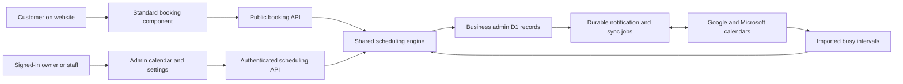

# Website and admin scheduling plan

Status: proposed architecture and implementation scope. Updated October 28, 2026.

Build scheduling as an optional capability shared by the website harness and the separate business admin harness. The website provides a consistent customer booking experience. The admin owns services, staff, availability, appointments, permissions, notifications, and calendar connections. Both use the same scheduling engine and authoritative appointment records.

The first release must accommodate different appointment businesses through settings, support immediate confirmation or business approval, and include external calendar sync. Target Google Calendar and Microsoft Outlook at launch. Deposits and payment processing follow the initial release.

## Product boundaries

Use a common appointment model with configurable service rules. Industry presets provide editable starting points; they do not create separate scheduling products or different booking interfaces.

| Business | Configuration using the common model |
| --- | --- |
| Salon or barber | Service duration and price, qualified staff, optional staff selection, cleanup buffers, immediate booking or approval |
| Consultant | In-person, phone, or video location; timezone display; intake questions; preparation buffers; personal calendar conflicts |
| Repair service | Diagnostic visit or drop-off appointment, equipment or vehicle questions, technician and bay availability, approval when the work needs assessment |
| Business visiting the customer | Customer address, service area instructions, fixed travel buffers, approval when the location or scope needs review |

A repair drop-off reserves the stated intake appointment; it does not promise a repair completion time. An uncertain project should offer a defined assessment appointment or an enquiry flow. Do not manufacture a fixed duration for unknown work.

The initial scheduling engine supports appointments with a defined start and duration, eligible staff, and optional exclusive rooms, bays, or equipment. Model resource requirements explicitly so a service can need both a person and a room. Capacity greater than one can initially use individually identifiable units. Classes, processing-time overlaps, route optimization, shift planning, multi-day jobs, and pooled capacity need later extensions.

## Ownership across the harnesses

| Concern | Website harness | Admin harness and scheduling backend |
| --- | --- | --- |
| Placement | Choose the booking route and relevant website calls to action | Publish which services and locations can be booked |
| Customer interface | Ship and verify the standard booking component and management page | Return permitted public service information and available times |
| Branding | Apply approved booking tokens from the site's theme | Expose operational settings without changing website source |
| Booking rules | Display rules, prices, and confirmation expectations | Calculate availability and enforce all rules |
| Records | Hold temporary selections in the browser | Store customers, appointments, resource reservations, revisions, and history |
| Access | Guest booking and limited access to one's own appointment | Owner and staff login, permissions, and record scoping |
| Integrations | Display availability and confirmation outcomes | Own calendar OAuth, synchronization, email jobs, and failures |
| Installation | Plan public connection metadata and verify compatibility | Install the module, migrations, bindings, and explicit configuration |

Recommended deployment: extend each business's existing admin Worker and D1 database with a trusted `scheduling` module. Create a narrowly defined public booking API on that Worker, alongside the authenticated admin API. A static website can call this API without running a second appointment backend.



Appointment records stay in the business admin installation. Existing website leads and analytics can remain in their current backend. Booking is a separate record type; an appointment must not also become a lead automatically or inflate enquiry counts.

Booking therefore requires a compatible admin installation or an explicitly provisioned scheduling installation built from the admin harness. It does not require enabling website form collection. The current installer requires a website backend connection: supporting scheduling without leads or analytics needs an explicit installer and connection-contract change, rather than a fabricated tenant or placeholder backend.

## Standard customer experience

The default destination is a dedicated `/book` route. Header and relevant service-page actions link there. A service action may preselect a verified service ID; the server still validates the selection. A location or staff step disappears when there is only one applicable choice.

The sequence is location if needed, service, staff if offered, date and time, customer details, review, then confirmation or an approval-pending receipt. Show the service, duration, price or explicit pricing basis, location, timezone, and applicable cancellation policy before submission. Avoid a mandatory customer account in the first release. Business users sign in through the existing admin; customers manage an appointment through a scoped email link.

Use one maintained component with a fixed layout and interaction contract. Permit controlled color, font, radius, logo, and wording options. Enforce readable contrast, minimum control sizes, consistent spacing, visible status text, and quiet motion. Agents may compose the surrounding website page; they must not redesign the internal booking steps per customer. Treat this as a deliberate functional primitive within the harness's otherwise site-authored design system.

Launch with the dedicated page and reusable booking links. An inline embedding option can follow once the same component is proven. Modal booking is unnecessary for the first release.

Required states include loading, no availability, next available date, validation errors, unavailable service, stale selection, slot taken, expired link, calendar connection unavailable, successful booking, and request awaiting approval. Keep entered details when a time becomes unavailable. A displayed time is not reserved until the server accepts the booking; do not introduce silent temporary holds while a visitor browses.

Use accessible date and time controls with keyboard navigation, clear focus, announced updates, and a simple list alternative. Verify narrow screens, zoom, long service names, long translations, empty states, and reduced motion. Do not delay booking controls behind decorative page animation.

The customer management page shows the current appointment and allowed cancellation or rescheduling actions. Time-limited email tokens authorize only that appointment, never the admin or a customer directory. Exchange a token from the URL fragment for a short-lived scoped credential; avoid tokens in analytics, referrers, logs, and browser persistence. A GET request or email link scanner must never change an appointment. Recovery emails use neutral responses and limits to prevent enumeration and mail abuse.

## Business configuration and admin experience

Add a Scheduling navigation destination with Calendar, Appointments, Services, Team and resources, Availability, Booking settings, and Calendar connections. Use the packaged React interface for the calendar; the current generic module table is insufficient.

Launch controls should cover:

- Day, week, and agenda views, staff and location filters, and appointment details. Mobile defaults to an agenda. Explicit edit forms are sufficient initially; drag and drop can follow.
- Services with description, fixed duration, price or pricing basis, eligible providers, resource requirements, location modes, buffers, online visibility, booking mode, and bounded intake fields.
- Business locations with addresses and IANA timezones. A provider working at multiple locations must have one shared conflict check across those locations.
- Weekly working hours, split shifts, breaks, holidays, date exceptions, staff leave, and temporary blocks. Personal calendars add further busy intervals.
- Booking lead time, booking horizon, allowed start increments, cancellation and reschedule cutoffs, approval expiry, and customer-facing policies.
- Manual appointments, approve or decline, cancel, reschedule, completed and no-show status, internal notes, and an activity history.
- Calendar selection, connect and disconnect, last successful sync, reauthorization, retry status, and conflicts requiring action.

Provide an editable business default and service-level overrides for immediate confirmation versus approval. Changing a default affects future bookings; existing appointments retain their policy snapshot. Approval-pending requests reserve their proposed resources until accepted, declined, cancelled, or expired. Proposed default expiry is 24 hours or the appointment start, whichever comes first; expiry is automatic and visible. Requests cannot accumulate indefinitely or bypass booking limits.

Availability changes do not silently cancel existing bookings. Warn about affected appointments and require a separate appointment action. Deactivating a service or staff member preserves history and existing appointment visibility.

Staff profiles and login accounts are separate: an owner can schedule a provider who has no login. Link an account explicitly when that provider should manage their calendar.

| Access profile | Intended scheduling access |
| --- | --- |
| Owner and administrator | All scheduling records and configuration, within the installation |
| Receptionist or booking manager | All appointment operations; configuration only through explicit grants; no account administration by default |
| Provider or staff | Assigned appointments and the customer details needed for them; own availability if granted |
| Existing editor and analyst | No scheduling access automatically |

Add scheduling permissions to the contracts package and define explicit role mappings. Candidate permissions are `appointments:read`, `appointments:write`, `availability:write`, `scheduling:configure`, and `calendar-connections:manage`. Each also needs server-enforced own-versus-all resource scope. A read permission must not imply booking writes or OAuth access. Providers connect their own calendars; acting for another provider requires separately authorized delegation and provider consent.

## Scheduling engine and stored data

Implement availability and appointment commands once, behind both APIs. The browser must never supply authoritative duration, price, approval status, identity, or permission decisions.

Core records are locations, services, providers, service eligibility, resources, availability rules, exceptions, customers, appointments, appointment resource reservations, customer access tokens, idempotency receipts, audit events, calendar connections, external event mappings, busy intervals, and durable jobs. Every scheduling record is constrained by the installation's `site.id`; related IDs must belong to the same site. Calendar mappings also identify the owning provider and connection.

Appointments store UTC start and end instants, location timezone, customer timezone when supplied, provider and resource assignments, service and policy snapshots, source, revision, status, and timestamps. Monetary values use integer minor units with an explicit currency. Snapshot duration, buffers, price basis, and cancellation terms so future edits do not rewrite a booking's meaning.

Store weekly hours as local wall times with the applicable IANA timezone. Expand them into actual instants for the requested date range, including daylight saving transitions. Define how nonexistent and repeated local times are handled; present ambiguous times with an offset. Never calculate a timezone as a fixed UTC offset. Persist exceptions as explicit dated intervals.

Availability is the intersection of location hours, provider hours, service eligibility, resource availability, booking windows, and notice rules, minus reservations, breaks, time off, and imported external busy intervals. Include buffers in the occupied interval. Use half-open intervals so a booking ending at a boundary does not overlap one starting there unless buffers require a gap.

Proposed appointment transitions are:

```text
submission -> confirmed OR pending_approval
pending_approval -> confirmed | declined | expired | cancelled
confirmed -> completed | no_show | cancelled
reschedule -> new validated time and assignments on the same appointment, with history
```

Rescheduling must secure the replacement resources atomically before releasing the old reservation. An invalid replacement leaves the original appointment intact. A service configured for approval sends customer reschedule requests through approval too; retain the original appointment until the replacement is accepted. Keep that proposal as a separate record rather than prematurely changing the confirmed start time. Reserve the proposed replacement until its approval deadline as well, excluding the same appointment's original claims from self-conflict checks. Limit each appointment to one active proposal and release the extra claims on rejection or expiry.

### Prevent overlapping native bookings

Use D1 as the initial authoritative store. Prove a database-enforced reservation design before building the full interface. An application-level availability read followed by an insert is insufficient.

Prototype overlap-rejection triggers or an equivalent atomic resource-claim design covering every required resource, appointment status, expiry, and schedule revision. All native bookings, manual entries, approvals, and reschedules use the same invariant. Imported external busy intervals remain separate: persist an external conflict with an existing appointment and flag it for resolution rather than rejecting the import or erasing the appointment. Busy imports invalidate the availability revision and block new overlapping reservations. Commit appointment records, claims, idempotency receipts, and durable jobs together. A stale availability or configuration revision must cause revalidation or a conflict, never silent acceptance.

D1 supports transactional statement batches with rollback on failure; this is a building block, not proof of the reservation algorithm. See the [D1 database API](https://developers.cloudflare.com/d1/worker-api/d1-database/). Make the proof an early release gate. If it cannot cover the required multi-resource operations, review an alternative storage design before implementation continues; do not add a Durable Object lock beside D1 and assume their separate writes form one transaction.

Bound searches, intake fields, request sizes, and date ranges. Return a conflict for a taken time, a revision conflict for stale admin writes, and a retryable outage for a failed dependency. Idempotency keys cover retries and reject the same key with a different payload.

## Calendar sync required for launch

Support Google Calendar and Microsoft calendars through a common provider interface. Define and test Google personal and Workspace accounts, and Microsoft personal and work or school accounts. Keep account-type support visible in connection setup.

Each provider can select calendars that block availability and a writable destination for harness-created appointments. External busy events block booking; appointment creation, rescheduling, and cancellation update the mapped external event. Disconnected calendars remain visibly disconnected. An ICS download helps customers add an appointment to their own calendar, but does not satisfy business calendar sync.

Export approval-pending requests and reserved reschedule proposals as clearly labeled busy holds, then update or remove those holds when the request is resolved. Staff-only calendar exports omit internal notes and unnecessary intake answers. Customer email and calendar invitations have one defined sender policy so a provider update does not accidentally send a second confirmation.

The native appointment is authoritative for customer commitments. Unrelated external events are authoritative only for their busy intervals. For launch, editing or deleting a harness-created event directly in Google or Outlook raises a reconciliation item; it does not silently reschedule or cancel the customer's appointment. Staff resolve the change through the admin, where normal conflict checks and notifications apply. State this behavior in connection setup.

Implement these operational rules:

1. Authorize a calendar connection through a server-side OAuth flow bound to the signed-in user, installation, intended provider, and exact callback. Use state and appropriate PKCE protections. Encrypt refresh tokens with a versioned key held in a Worker secret; never return them to the UI or store them in public site files.
2. Import busy intervals over the booking horizon, handle recurrence, exceptions, all-day events, transparency, and provider busy semantics, and exclude mapped native appointments from being counted twice. Minimize imported content; external titles and attendees are unnecessary for public availability.
3. Subscribe to changes, renew subscriptions, retain sync cursors, and reconcile periodically after missed notifications. Webhooks trigger authenticated provider reads and cannot directly mutate arbitrary appointments. Validate provider-specific channel or subscription ownership and replay behavior. Google documents [change notifications](https://developers.google.com/workspace/calendar/api/guides/push) and [incremental synchronization](https://developers.google.com/workspace/calendar/api/guides/sync). Microsoft documents [notifications](https://learn.microsoft.com/en-us/graph/outlook-change-notifications-overview) and [calendar-view delta synchronization](https://learn.microsoft.com/en-us/graph/delta-query-events).
4. Recheck external busy state immediately before accepting a new time. Handle per-calendar failures, not just successful HTTP status. Google exposes calendar-level errors in its [free/busy API](https://developers.google.com/workspace/calendar/api/v3/reference/freebusy/query). Microsoft's [getSchedule API](https://learn.microsoft.com/en-us/graph/api/calendar-getschedule?view=graph-rest-1.0) does not support delegated personal accounts; use an account-compatible calendar-view strategy for those accounts.
5. If a required calendar cannot be checked, stop new bookings for the affected provider and show a useful recovery path. Keep existing appointments available. The owner may explicitly disconnect a calendar and accept native-only operation; do not silently disregard it.
6. Commit the native appointment and a durable export job atomically. Send provider writes with stable mappings and provider-supported idempotency or reconciliation. A timeout must not create duplicate external appointments on retry. Keep email delivery, calendar export, and appointment status separate.
7. Show pending exports, retry with backoff, reconcile uncertain writes, and alert staff after persistent failures. New bookings for an affected provider pause while an unresolved export could make that provider's external calendar misleading. Never report successful sync solely because a job was queued.

External calendars and D1 cannot share an atomic transaction. A provider can add an event between the final external check and the native booking commit. Reconciliation must identify this conflict promptly and ask staff to resolve it without silently cancelling the customer. Native overlap prevention is a hard invariant; cross-provider conflict avoidance includes this explicit race and recovery behavior.

Provider onboarding is a launch dependency. Preserve business-owned installations by supporting customer-owned Google OAuth and Microsoft app registrations with exact callbacks. Confirm production consent, required verification, scopes, and account policies during the first phase. A shared Vitris-operated OAuth app is a separate product and operations decision; it must not become an undocumented central dependency. Calendar authorization is separate from admin login.

## Public API and trust boundaries

The existing admin Worker checks all mutation Origins against the admin origin, and its module routes require a signed-in session. Add an explicit public route dispatcher; do not loosen those global checks for existing admin endpoints.

Proposed API families are:

| API | Purpose and authority |
| --- | --- |
| `/api/booking/v1/catalog` | Published service, provider, location, policy, and presentation data only |
| `/api/booking/v1/availability` | Bounded available-time queries without private appointment details |
| `/api/booking/v1/appointments` | Validated guest submission with abuse controls and idempotency |
| `/api/booking/v1/manage/*` | Read or change one appointment using scoped customer authority |
| `/api/modules/scheduling/*` | Signed-in admin operations with existing session and Origin protections plus scheduling permissions |
| `/api/scheduling/oauth/*` | Provider connect and callback routes with dedicated flow validation |
| `/api/scheduling/webhooks/*` | Provider notifications with provider-specific validation |

These paths and proposed commands below do not exist yet.

Public browser calls use exact registered website origins, credential-free CORS, server-side site identity, rate limits, bounded inputs, and bot challenges where appropriate. CORS is not authentication and cannot stop scripted abuse. Booking a time may require a short-lived email verification proof under an explicit abuse policy; verification must not silently hold a slot. Never expose an admin cookie, `HARNESS_API_TOKEN`, forms setup token, OAuth secret, or deployment credential to the public component.

Public data must exclude customer identities, other appointments, staff private notes, and external event contents. Keep booking and appointment management routes out of shared caches; exclude token-bearing pages from indexing. Store customer details only where operationally needed and support business-controlled retention, export, and deletion without destroying required audit relationships. Marketing consent is separate from appointment messages. Appointment operations must work when optional analytics consent is refused.

Notifications use a durable outbox with retry, delivery status, and revision-aware cancellation of obsolete reminders. Initial messages cover confirmation, request received, approval, decline, reschedule, cancellation, expiry, and email reminders. Use the customer's configured transactional sender with separate send limits. Test mode captures messages and calendar writes in isolation; no real customer notifications occur during previews.

## Harness knowledge and installation workflow

Create stage-scoped `agent/refs/scheduling.md` and load it only for sites requesting scheduling. Teach the business stage to identify actual services, location modes, provider selection, approval needs, calendar requirements, existing scheduler, and missing operational facts. The narrative stage chooses placement; implementation installs the standard component; browser and quality stages exercise it. Preserve supplied business wording and existing external booking links until a reviewed replacement is ready.

Separate presentation from operational configuration. Proposed `launch.json.scheduling` contains public enabled state, schema version, booking API origin, public site identity, and route. Service data, working hours, prices, and policies are maintained through the admin and read dynamically; changing availability must not require rebuilding a website. Preview assets contain no live access credentials.

Proposed tooling is `vitris scheduling inspect`, `setup --plan`, `setup --apply`, `status`, and `verify`. Plans show the exact website and admin identities, public origins, compatible releases, configuration diff, and readiness gaps. Apply local connection metadata only through explicit reviewed changes. Treat module installation, remote schema migration, provider authorization, notification onboarding, and deployment as separate operations. A scheduling plan must not activate live booking as a side effect.

Use `disabled`, isolated `test`, and explicitly activated `live` server modes. Local previews use synthetic fixtures or an isolated test backend. Production mode is a server decision, never a client flag. Existing sites adopt the component explicitly; upgrades preserve authored files, state, launch settings, forms, grants, and progress.

The website currently delegates admin setup to exact published `0.1.0-alpha.1` packages. Scheduling needs a newly released compatible contracts/runtime/initializer set and an explicit website pin update. Do not imply that the current alpha already supports it or switch existing installs to an unreviewed version. Runtime capability checks must verify deployed identity, API version, enabled scheduling module, schema readiness, and test/live mode independently of local scaffold metadata.

## Implementation phases and completion gates

| Phase | Work | Completion gate |
| --- | --- | --- |
| 1 Product and architecture | Approve the standard booking wireframes, configuration matrix, permissions, lifecycle, provider support, and OAuth operating model. Prototype reservation atomicity and both provider integrations. | Concurrent reservations are proven safe; real designated test calendars connect, read busy state, write, update, cancel, and recover from revocation. Both harness contracts are specified. |
| 2 Admin scheduling foundation | Implement additive schema, engine, appointments, availability, services, staff/resources, role scoping, calendar and settings screens, and durable jobs. | Manual appointments and approval work locally; migration from the previous supported schema preserves users and records; disabled and unauthorized access fails. |
| 3 Website component and agent support | Build the standard component, customer management, public API, preview fixtures, setup plans, compatibility checks, and stage-scoped guidance. | A customer books or requests a time, sees it in the admin, and can reschedule or cancel under policy. Salon, consultant, and repair examples use the same component. |
| 4 Calendar synchronization and notifications | Complete both provider adapters, OAuth setup, notifications, subscription renewal, reconciliation, export retries, and operational health screens. Integrate the phase 1 prototypes into the durable jobs. | Real test-account sync and notification delivery pass, including failures, concurrent external edits, disconnected accounts, duplicate callbacks, and restart recovery. Calendar sync is required before launch. |
| 5 Packaging and pilot | Verify packed packages, installation and upgrade plans, performance/accessibility, backup and recovery, and an explicitly authorized pilot in a customer-owned account. | Verified local website `dist/` preview and isolated admin acceptance evidence; after separate rollout authorization, canonical domains, real staff login, authoritative appointments, and both calendar providers pass live checks. |
| Later capabilities | Deposits, refunds, SMS, waitlists, recurring customer bookings, classes, advanced resource capacity, processing-time overlaps, route planning, automatic meeting links, and customer accounts. | Each adds explicit contracts, permissions, failure behavior, and acceptance coverage. |

The work spans two repositories. In `vitris-harness`, expected touchpoints are `src/types.ts`, `src/build/index.ts`, `src/compile/site.ts`, new scheduling runtime/compiler support, launch validation and CLI wiring, agent graph and scoped references, documentation, and package exports/files. Keep sites without booking free of its runtime and payload.

In `website-admin-harness`, expected touchpoints are `packages/contracts/src/`, `packages/admin/src/worker.ts`, new trusted scheduling engine/module/provider sources, `packages/admin/ui/src/`, new numbered migrations after the existing sequence, installer/manifest validation, packaged workflow references, and acceptance/package tests. Existing routes retain their authentication behavior. Record the implementation plan in that repository's `agent/changes/` when implementation begins.

Keep calendar-provider adapters separate from appointment rules and the public booking contract. Evaluate maintained libraries for timezone arithmetic and accessible controls during phase 1; select exact dependencies through normal package review. Do not silently add a paid scheduling platform or a central Vitris account service.

## Acceptance requirements

- Two simultaneous requests for the last time or shared room produce at most one accepted reservation. Cover overlapping durations, buffers, adjacent intervals, multiple resources, cross-location providers, retries, pending-request expiry, and concurrent availability changes.
- A failed reschedule keeps the original appointment; concurrent edits produce a visible revision conflict. Changed services and policies do not rewrite historical snapshots.
- Exercise spring and autumn daylight saving transitions, repeated times, overnight hours, holidays, different customer timezones, and locations with different timezones.
- Verify all role and scope boundaries, disabled modules, revoked sessions, cross-site IDs, public-data filtering, token expiry, email-link scanners, origin checks, request limits, and abuse handling.
- Test Google personal/Workspace and Microsoft personal/work accounts; include read-only calendars, recurrence, all-day busy periods, deleted events, token revocation, expired subscriptions, missed and duplicate callbacks, provider outages, rate limits, and uncertain export results. Automated stubs and live designated test accounts provide separate evidence.
- Demonstrate confirmations and approval-pending receipts, cancellation and rescheduling, empty and failed states, mobile and keyboard access, and preserved inputs after a conflict. Verify that optional analytics rejection does not disable booking.
- Install and upgrade from packed artifacts outside the workspaces. Run the website repository's typecheck, full tests, and package verification, and the admin repository's `npm run check` plus packed-package acceptance. Preserve frozen fixtures and historical baselines; add new synthetic scheduling fixtures instead.
- Verify notification and calendar jobs survive failures and restarts, test traffic cannot reach live calendars, backups restore appointment history and resource claims, and operational failures are visible without exposing customer content or secrets.

Release scheduling as an explicit opt-in. Pausing new bookings is the first recovery control; preserve existing appointments, customer management access, and recovery jobs. Review restoration and compatibility before rollback. No cloud provisioning, backend migration, npm publication, or customer rollout is authorized by this planning document.
